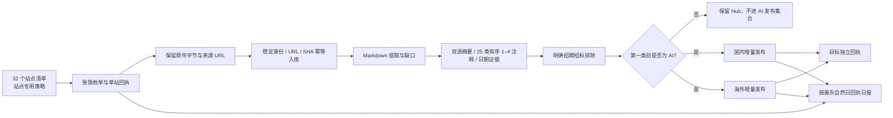

# 流程、现状与实施边界

## 当前实现状态（2026-10-25）

跟踪源码现含 32 项 bounded discovery、URL/SHA 版本化 Hub v3 live-capture、Luna/high 双语分类和三类日期补全、两目标独立文章写入与原生 KB/Ready 以及可恢复 v2 回执。代码和隔离测试通过后仍需 fresh review 与 IAA/CAS 低流量真实验收；这份设计记录中标为“待实现”的旧叙述只代表历史审计时状态。当前命令、配置和 pilot 次序见 [本机运行指南](runtime.zh-CN.md)。生产 automation 不由 CLI 修改。

## 每轮与日报

用户确认的目标是每日轮换 32 个监控项：helper 按固定 America/New_York 日期锚点，每天取六个 baseline，最多再选两个不同站点做历史失败重试。连续任意七个自然日的六项 baseline 覆盖全部 32 项；这是计划覆盖，未运行站点仍报告 `not_run`，不能算成功。Istituto 保留 baseline 位置但为 hold，IABA/EAA 为仅做结构检查的 `monitor_only`。日计划目标为美东 06:00，09:00 日报覆盖前一美东自然日。日期而非 UTC 经过小时推进，因此跨 DST 不重复或跳过计划日。单站失败不减少其余 baseline，也不改变未来日期轮换。每站其他低频配置和真实执行端仍待实现。

流程目标如下。粗线外的站点脚本仅提供本仓库现有证据；适配器和持久调度尚待实现。

执行顺序应保持可恢复：单站独立超时和输出；原文件先按哈希归档，再关联规范来源 URL；Markdown 保存解析器版本、状态和空正文缺口；双语生成使用已核准的 25 类规范键，最多 4 个且有序，不依据 URL/标题关键字推断正文分类；分别保存 `publication_date`、`revision_date`、`document_version_date` 的值、precision 与 evidence，不把 HTTP Last-Modified 或活动日期混作发布日期。源阶段失败时保留已落盘证据，不重复改写既有内容。

每日回执用 v2 `date_local/site_id` 唯一键记录本地自然日一次最终结果。失败/partial stage 携带错误和证据；report 从真实回执生成 case ID 和研究队列，最多建议两项。Case ledger 由调用端原子写入，不由 helper 修改。失败状态按同一 site/stage 保留，后续回执缺字段或 unknown 不会关闭它；只有该阶段新的 succeeded 证据才能关闭。最新 receipt 的下载成功不能掩盖之前 overseas Ready 失败。研究应先复现并定位证据，再更新仓库维护的实际 script/playbook/skill，跑聚焦测试与低流量验证、交独立 review，次日通过新回执确认；不得靠改报告/skill 把失败写成成功。相同 case 与 evidence fingerprint 不重复研究，单次日报最多处理两个；临时 HTTP/服务问题按证据退避。若维护源只存在 ignored snapshot，则不能伪装已经部署修复。

## 已跟踪运行端与历史复用证据

32 个监控项（29 个唯一入口 hostname；SOA 和 CIA 各含专题监控项，CAS 还跨期刊 host）均已有 `collect.py`、`playbook.md`、`filters.json`、`status.json` 的只读副本。它们不是 32 个独立 Skill，仓库另有一个共享采集 Skill。脚本均可解析，但产物、运行时依赖、游标与过滤语义并不统一；候选枚举不等于下载、Hub 入库或完成摘要分类。`status.json` 是历史快照，不是本轮回执。逐项问题和建议见 [监控项目录](sites.zh-CN.md)。

可复用既有 Hub 的原文件/Markdown 入库、双语生成与导入、25 类版本注释、AI-only 发布下游组件；但当前 Hub importer 使用关闭的 SQLite v16 快照，不是 live 增量 API；simple-runner 绑定了固定历史 run。先参数化 runner，再给发现、生成与导入加逐来源版本、URL/SHA 和幂等续跑的输入/回执合同。PipelineBaton 可继续用于文章进入应用库后的 Markdown、catalog、chunks、embedding、KB/Ready 任务和 task history；它固定一个下游步骤链，其每小时巡检 tick 是另一条下游队列，与本次每日来源轮换无关。文章富信息回填脚本可复用哈希绑定与追加注释规则，不应重跑历史全量回填。分类复用 `reports/category-taxonomy-review-20261016/proposal.json` 的 25 类规范 key；日期三字段与精度/证据规则沿用已批准的 article-enrichment 规则。当前发布规则只接受有序 `categories[0].key == "AI"` 的 Hub 版本。第二至第四类仍按原顺序及证据保存，但不能让 AI 次分类入选。历史列表、计数、缓存重试与目标 worker 都使用同一首类规则；不要改写 Hub 原始 primary 类别来制造入选资格。

| 可复用历史组件 | 原仓库本机路径 | 本轮可复用内容与边界 |
|---|---|---|
| 来源采集及 Hub 导入 | `reports/agentic-collect-20261011/collect_local.py`、`import_local.py` | 复用下载、原件/Markdown 与 Hub 导入思路；需做逐来源增量、URL/SHA 幂等和可复核回执。 |
| Docling 缺失文档转换 | `reports/docling-gpu-20261011/convert_missing.py`（以及 `loop_run.py`、`build_snapshot.py`） | 复用正文转换；建议单 worker 有界运行并记录空正文，不据此反复下载。 |
| 双语 metadata runner | `reports/bilingual-metadata-worktree/reports/bilingual-metadata/simple-runner/{generate_metadata.py,import_metadata.py}` | 复用双语与分类注释语义；入口绑定固定历史 run，需先参数化增量输入。 |
| Enrichment | `reports/article-enrichment-20261016/ops/enrich.py` 与 `task.json` | 复用 URL/SHA 哈希绑定与追加注释；日期保留三字段、precision、evidence，不重跑全量历史任务。 |
| Taxonomy | `reports/category-taxonomy-review-20261016/proposal.json` | 复用已核准 25 类规范键及顺序约束，不新造分类表。 |
| AI 双端导出/替换 | `reports/ai-only-replacement-20261015/ops/export_ai_articles.py`、`replace_articles.py` | 只复用已确认分类的 AI 下游语义；旧导出漏检辅助类别，替换脚本会清空再重建，禁止周期调用。 |

这些 `reports/` 历史操作资产在忽略的本机报告目录中，当前 clone 未跟踪它们；它们不是新 clone 可直接调用的现成命令。实施时应把批准的最小代码/合同纳入跟踪源码，并为输入输出参数化与测试。

初始资源预算建议由 adapter 配置并经真实低流量验证：每个监控项每轮最多 30 次总 HTTP 请求（列表、详情、附件合计），请求间隔至少 0.5 秒；Docling 同时 1 个 worker，metadata 生成并发不超过 3，两个目标的写入串行。分页游标必须持久化并继续到结束，不能永远只取前 N 页；无可靠游标的源用有界轮换复扫并依赖幂等去重。预算是待实现与验收要求，不是现有脚本已满足的运行配置。

既有旧 `ingest_urls.sh` 的 `type=file` 与全局 `NOISE` 不可原样套到 25 类资料范围：例如 education/events、exam 和 proceedings 可能是许可主题。继续使用既有已确认招聘/招标 URL 排除表；其他排除须有站点范围和正文证据，记录被排除候选及理由，不能从关键词过滤推断“已覆盖”。

元数据 `sync-catalog` 只能填充已有目录项，不会创建新文件或正文。因此每站 serving adapter 需先按新规范 URL / Hub version 建立文章与原件，再追加/更新双语 metadata；target acknowledgement 按 article/version 和目标单独保留，记录写入/回读结果。两个站使用不同的 embedding 模型及向量维度（国内 1024、海外 3072），各用本站已配置 profile 重建受影响 chunks / KB / Ready；不互抄向量，不改账号、聊天设置或既有模型配置。日报在每个目标 acknowledgement 下另列 `ready_status_counts`；ack 成功不代表本站索引已 Ready。

周期入口不能调用 `reports/ai-only-replacement-20261015/ops/replace_articles.py`：这是清空旧目录式替换流程。也不能只用旧 `export_ai_articles.py` 当筛选器。采集内容入库仍需明确的本地 Hub 写入 adapter；helper 只读取轮次回执并输出 JSON 日报。没有 adapter 的写入回执时，不能声称采集内容已入 Hub。

## 现存阻塞与最小实施顺序

审计读取了两站的只读公开运行信息：截至 2026-10-25 两边都是 322 篇 visible/catalog，服务器 `Scheduled Collection=false`；周报开关为 true。Docker 未启动，本机 Hub 无法连接。站点入口各只做了一次本机 GET：30 个收到响应；IFoA 配置的 `www` 返回 503，但按 playbook 的无 `www` 规范入口成功；Istituto 响应为 placeholder/demo，暂 hold。入口成功只说明入口可达，不证明 sitemap、附件、robots、正文或完整采集覆盖。CAA 附件和个别站点的公开探测也不构成全量可采证明。

实施建议按顺序进行：

1. 为 IFoA 配置无 `www` canonical 入口并保留旧 `www` PDF 来源别名；Istituto 先保持 hold，低频确认是否恢复或换权威源。按 32 个监控项完善 robots、分页、附件、host 白名单和限速检查。
2. 将候选统一成单站独立结果：规范 URL、站点 ID、文件 URL、last-modified（若有）、候选类型、过滤理由、SHA、下载与解析状态。分页或完整 sitemap 扫描只应在真正存在 lastmod 游标时按游标增量；无游标站使用有界重扫，依靠幂等身份去重。
3. 建立 local Hub/source adapters，拆开抓取、存原件、Markdown、双语生成/导入、分类/日期缺口、AI 候选与 JSON 日报输出，每阶段写可续跑回执。先 parameterize 现有生成/导入 simple-runner，避免耦合固定历史操作路径。
4. 建立国内与海外两个增量 serving adapters。明确 upsert identity、文章/正文创建、缺口和删除处理；每目标独立验收文章、metadata、chunks、KB/Ready 和 native acknowledgement，任何一边失败不得以另一边成功代替。
5. 真实 Hub 与两目标验收通过后，才启用每日 06:00 的六项 baseline/最多两项额外失败重试触发器，并落实单实例租约、可恢复状态、运行日志/保留期与机器关机后的追赶策略。美东 09:00 日报只能据真实回执报告逐站状态、计划与实际覆盖；无回执显示 not_run，不能代替采集或 Hub 写入。helper 本身不创建或启用触发器。

此离线 helper 本身不创建或启用 Scheduler。若用 ChatGPT automation 作为触发器，官方说明要求电脑开机且 Codex app 运行；参见[官方 automations 说明](https://learn.chatgpt.com/docs/automations?surface=app)。
